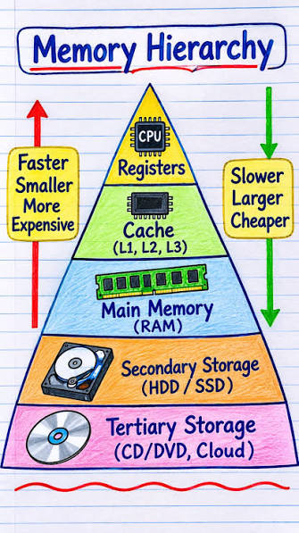

# LIBASM

*This project has been created as part of the 42 curriculum by bsuger*

Summary: The aim of this project is to become familiar with assembly language.

## THE PROJECT

We are building a library (libasm.a) written in assembly with the following functions:

◦ ft_strlen (man 3 strlen)
◦ ft_strcpy (man 3 strcpy)
◦ ft_strcmp (man 3 strcmp)
◦ ft_write (man 2 write)
◦ ft_read (man 2 read)
◦ ft_strdup (man 3 strdup)
◦ ft_atoi_base 
◦ ft_list_push_front
◦ ft_list_size 
◦ ft_list_sort 
◦ ft_list_remove_if

We are allowed to call the extern errno_location.
We should check errors during syscalls and handle them properly when needed.

## REQUIREMENTS

To launch the project you'll need:
-A Linux distribution (x86_64)
-Make
-NASM
-LD

## EXPLANATIONS

This part explains more about each function and some concepts.
You'll find more details in the "Posts" section of my GitHub repo.

### 'It is forbidden to use the compilation flag: -no-pie'

*This sentence comes from the subject*

While the idea of doing it is kind of crazy, we need to understand what we are talking about.
PIE stands for Position-Independent Executable. It means that each time we launch our ELF, it can be loaded at a random place in
virtual memory without impacting the program. It's not PIE itself doing it: the kernel's ASLR does it, while PIE makes it possible. So we don't have hard-coded memory addresses inside our code, and
we avoid easy ROP (Return-Oriented Programming) exploits (that's when you know where you have to offset the code to take control).

So this rule in the subject is there to make sure we do it the right way.

### What is x86_64

Computers come with different CPUs, and CPUs can have different architectures. x86 is one of them!
The "_64" is there to specify that it's 64-bit.

This whole project is built for this architecture.

### Memory Hierarchy



With assembly you are manipulating registers, the lowest level usable by humans in programming. They are also very fast to use and manipulate, as you can see in the image above.


### What is the System V ABI?

System V ABI is a standard specification that defines low-level binary compatibility for compiled application programs running on Unix and Unix-like operating systems.

It also defines what we call the "Calling Conventions", which is important for our project for a specific detail:

-callee-saved registers: the ones we need to restore if we modify them during our function (rbp, rsp, rbx, r12-r15)
-caller-saved registers: the called function can modify them without any issue (all other registers)

Function arguments are put (in order) in these registers: rdi, rsi, rdx, rcx, r8, r9.
The return value of functions or syscalls is in rax.
To make a syscall, you put the syscall number in rax.

### Man

In man 2 syscall you can find valuable information if you forget the order of arguments and return values.
I also found interesting information in man 2 intro about syscalls and libc wrappers.

### Intel and AT&T syntax

We write with Intel syntax as God intended. That's it!

### Leaf and non-leaf functions

Leaf function => does not call any other function
Non-leaf function => calls another function

With a non-leaf function you have to guarantee that rsp is aligned on 16 bytes for each call.

### section .note.GNU-stack noalloc noexec nowrite progbits

You'll find this directive in each of the functions. It's there to avoid warnings when the code is used with C.
Without it, the linker assumes that it needs an executable stack (an executable stack can be used for nested functions in C, for example).

### ft_strlen

This is where we meet our first loop, and where you learn the trick of starting the counter at -1, which allows you to write a better loop.
There is also another interesting trick: setting the register to -1 with the or instruction. While or takes 4 bytes and mov takes 7, or depends on the previous value inside the register.

### ft_write

The first function where you encounter errno.
You make your syscall => the value in rax can be negative if there is an error (a value between -1 and -4095).
This value will help us with __errno_location => we need to call this extern function with wrt (for NASM, it stands for With Respect To) and ..plt (Procedure Linkage Table => Global Offset Table).
The errno_location function gives us an address in rax where we can put the value found previously.
In my solution I decided to push rax, both to align the stack (the System V ABI requires 16-byte alignment) and to save the value, rather than putting it into a specific register.

### ft_strcmp

An interesting function where you see 2 new instructions:
*test*
=> a common way to test whether a register is 0 or not (using it on itself); it's an and operation that discards its result.
=> xor writes the result in a register, while test only changes the flags
=> test is smaller than cmp (2 vs 3 bytes)

*movzx*
=> used to mov and zero the rest of the register
=> done here because we have to compare unsigned chars (so we don't use movsx)
=> We do it on eax so that the upper part is zeroed too.

### ft_strdup

A function where you have to reuse other functions: ft_strlen and ft_strcpy.
To do that you just have to declare them as extern.
As with ft_write, you have to be careful about the 16-byte alignment.

### struct and list.inc

A very interesting part of the bonus is the use of structs. We know them from the C programming language. In assembly programming it's very interesting to see them "raw". We knew from the beginning that a struct is a memory layout (with possible padding), but as we don't have any struct keyword (in a way we do, but please keep reading), we see that it's mainly pointer arithmetic.

Fortunately, there is a nicer way of writing the offsets with NASM.

```asm
struc t_list
	.data:	resq 1
	.next:	resq 1
endstruc
```

The "resq 1" directive allows you to reserve 8 bytes, the size of a pointer.

So now if we want to use it we can simply do:

```asm
mov rax, [rdi + t_list.next]
```

This way, rax gets the content of next.

We have 2 options to use this struc. First, we can put it at the top of each of our files that touch the structures. Second, like in Libft, we can use an include. It is very similar to libft.h, but here it's a list.inc.

We will also include it at the beginning of each file where it's needed:

```asm
%include "list.inc"
```

### ft_list_remove_if

The first function where I really used the concept of callee-saved / caller-saved registers, because I have a lot of arguments. I used rbx / r12 - r15 to save all my arguments before calling other functions.

### test and cmp

At some point I learned that 'test' is smaller than 'cmp', and I tried to replace them as much as possible.

### ft_atoi_base - check base

I didn't want to do the same thing as I did in libasm => O(n^2) / nested loops. I learned a trick from pwn.college for this => use a sort of set that I create myself. For that, I reserve a big chunk in the stack frame => "zero" it (in my case with 255) => this way I know whether I already set a value or not, using an offset.

That's what I learned from pwn.college, but I decided to go further with this idea. I set each value of this "set" to the value that will be used later for the conversion.

### ft_atoi_base - first time

This is the first time in libasm that I really had to use the concept of caller-saved / callee-saved registers to its fullest.

At the beginning, I start by saving my arguments in r12 and r13, but to do that I first need to save r12 and r13:

```asm
	push r12
	push r13
	mov r12, rdi
	mov r13, rsi
```

### ft_atoi_base vs ft_atoi_base piscine

In the Exercices part of the repo, I created a version of atoi_base like the one in the piscine. But that's not what we want! They want a version like ft_atoi => which implies copying "atoi" => which changes how we handle signs => atoi refers to strtol, which only accepts one "+" or "-" sign.

### ft_list_remove_if and partial register stalls (or not... what the helly is happening)!

An exercise about pointers! Not as easy as I thought it would be. The strategy I used is to change the pointers' content if needed.

But the most intriguing thing I learned with this one is the following => in the System V ABI, it is said that if a function returns an int, the upper half of rax may not be changed. We can only rely on the value of eax, not of rax. Why? Because the function may have used, for example, al or ah, which does not reset the higher bits. This is called a partial register stall! And in this exercise (and the following one) I discovered it the hard way! Or so I thought..... In my case it was not a partial register stall (even if it can happen); it was the fact that I forgot strcmp can return negative values => 0xFFFFFFFF, but if you read it through rax you get 0x00000000FFFFFFFF, which is not the same value => my cmp (if) was triggered as if the value were positive when that's not the case.

While discovering this concept, I also learned about partial flag stalls. An instruction like inc / dec modifies all the flags except one (CF).

## RESOURCES

[PWN COLLEGE](https://pwn.college/): pwn.college is a program from Arizona State University. Everything is free! Labs with videos about cybersecurity. I absolutely love it!
To prepare for Libasm you should use the "Computing 101" path, but in the archives you'll also find lesser-known useful resources in "Assembly Crash Course" (which is
the first asm course made by pwn.college).

[Linux Syscall table](https://filippo.io/linux-syscall-table/)

[The microarchitecture of Intel, AMD and VIA CPUs](https://www.agner.org/optimize/microarchitecture.pdf)

[Tips for golfing in x86_64 machine code](https://codegolf.stackexchange.com/questions/132981/tips-for-golfing-in-x86-x64-machine-code) Where I learned about instruction sizes and the trick for ft_strlen to set -1 at minimal cost (the or operator, but I didn't use it in my strlen for other reasons)

[Set all bits in CPU register to 1 efficiently](https://stackoverflow.com/questions/45105164/set-all-bits-in-cpu-register-to-1-efficiently)

[Why do x86-64 instructions on 32-bit registers zero the upper part of the full 64-bit register?](https://stackoverflow.com/questions/11177137/why-do-x86-64-instructions-on-32-bit-registers-zero-the-upper-part-of-the-full-6)


[x86 video playlist from OliveStem](https://www.youtube.com/watch?v=yBO-EJoVDo0&list=PL2EF13wm-hWCoj6tUBGUmrkJmH1972dBB)

[How does glibc make a system call in Linux?](https://youtu.be/NVXJZUa0kKo?si=XLUzi-4USffP0Btq)

[CPU Land](https://cpu.land/)

[Calling Convention](https://en.wikipedia.org/wiki/Calling_convention)

[Where the top of the stack is on x86](https://eli.thegreenplace.net/2011/02/04/where-the-top-of-the-stack-is-on-x86)

[NASM Tutorial](https://cs.lmu.edu/~ray/notes/nasmtutorial/)

[ASM Tutor](https://asmtutor.com/): Great exercises, but the solution is given too fast. Not sure what the initial plan was there. But it helped me create my own practice.

[Learn x86-64 assembly by writing a GUI from scratch](https://gaultier.github.io/blog/x11_x64.html)

[Some Assembly Required](https://github.com/hackclub/some-assembly-required/)

[System Inside; ASM](https://0xax.dev/books/asm/)

[What Happens When a CPU Receives an Unknown Instruction?](https://youtu.be/WtlGB-YVLOg?si=goHdHTmApaQdiONL)

[(French) Conventions d'appel](https://beta.hackndo.com/conventions-d-appel/)

[(French) Stack introduction](https://beta.hackndo.com/stack-introduction/)

[(French) Assembly Basics](https://beta.hackndo.com/assembly-basics/)

[(French) Introduction a GDB](https://beta.hackndo.com/introduction-a-gdb/)

[Algorithms for Modern Hardware](https://en.algorithmica.org/hpc/): Not totally related to the subject. Goes deeper than needed for the project, but helped me learn how computers
work with modern hardware.

## The use of AI

For this project, AI was primarily used to correct the English in this document.
It was also used to help me create tests for my functions.
AI also helped me with practice exercises before doing libasm; then I extended the practice side on my own with various resources you can find here [LINK]
It helped me generate a cleaner version of my Makefile for the debug option and the includes in the bonus part.

## Why did I take this subject? What did I learn?

After completing the Core Curriculum at 42 school, you can choose from a lot of subjects without any obligation.
So why did I take this subject?

I wanted to learn more about computer architecture. Even if this subject doesn't require it, it's the lowest level you can get to while programming to see how computers work.
So I took this opportunity to look at how computers work: registers, L1/L2/L3 caches, ALU, FPU, RAM, disk, etc.

So here is a summary of everything I learned:
-Computer architecture
-ISA (CISC vs RISC)
-How the CPU works
-SIMD
-Translation of code to CPU instructions
-The compiler's work behind the scenes and its optimizations
-Intel and AT&T syntax basics (but stick to Intel syntax as God intended)
-Compiler output with different optimization levels
-NASM
-Foundations for reverse engineering CTF challenges
-Better use of GDB to inspect ELF files without debug flags
-Better use of objdump
-PLT / GOT with glibc

## SIMD

About SIMD: while I had the idea of using it for at least ft_strlen() and a few other functions, I decided not to write it and to keep things scalar.
The main reason is the time constraint I had, but I explored SSE2 and AVX concepts while doing my research on Assembly.

## FUN FACTS

While exploring godbolt and different compiler stuff, I discovered a way of "cheating" on some functions. 
It's not really a cheat but a very helpful way of comparing your asm to the compiler's work....

While using godbolt I did this: [godbolt output for a ft_strlen](https://godbolt.org/z/oYT4f6hWv)
The GCC compiler uses the real strlen it knows => because GCC recognizes the strlen idiom (looking for '\0'). The strlen in libc uses SIMD, which makes the substitution interesting.

So in order to avoid optimizations like that, you need to add some flags: [godbolt output for a ft_strlen with -ffreestanding](https://godbolt.org/z/czejWqrsa)
What do we see? A very clean version of ft_strlen, very close to mine (but mine is better, and yes, it's the ego talking right here)

So maybe.....you can pass your C code directly to godbolt with this flag and everything will work out: [godbolt on ft_strcmp with -ffreestanding](https://godbolt.org/z/344G7jcv3)
*You have to know that 42 students have already done most of those functions in C at the beginning of their curriculum*

It works!
Is it good? No, but it's not THAT bad
Is it useful? A little bit for small functions; after that you need to do it yourself
Is it fun? YES!
